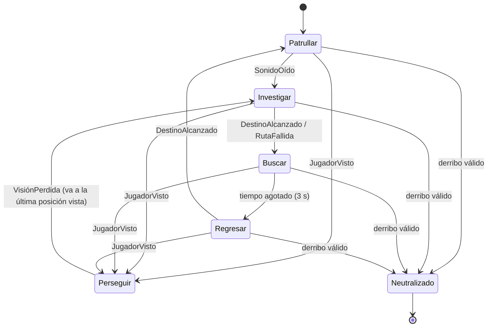

# Escapa del Sótano — Presentación

**TP final integrador PIAPC (UNRaf) · Juan Martin Vianco Hail**
Demostración en vivo: `npm ci` y `npm run dev` (ver [README](../README.md)).

---

## 1. Idea y demostración

- Te secuestró una mafia. Tenés que **tomar el cuchillo**, **neutralizar al matón por la espalda** y **escapar** con su llave.
- **Poca luz:** solo ves 3 celdas alrededor (2,25 en el nivel 2). Los vidrios aparecen de cerca.
- **Ruido:** caminar hace ruido; con Shift vas en silencio, pero más lento. El vidrio siempre suena.
- **Derrota:** si el matón te alcanza mientras te persigue, se reinicia el nivel.
- **Recorrido para la demo:**
  1. Jugar el nivel 1 con oscuridad.
  2. Activar **V** para mostrar la IA.
  3. Generar sótanos con **G**.
  4. Cambiar búsqueda (**Espacio**) y navegación (**C**).

---

## 2. Escenarios generados

- **Laberinto con atajos:** un laberinto de pasillos (recorrido en profundidad aleatorio) al que se le rompe un 18 % de las paredes internas, para crear varios caminos.
- **Cámaras:** se abren 5 o 6 cámaras más amplias, repartidas en una grilla de 3 x 2 sectores.
- **Decisión propia:** la primera versión usaba salas unidas por pasillos. Al jugarla parecían "cubículos" y se cambió por el laberinto.
- **Objetos:** 4 a 8 cajas (obstáculos), 15 a 25 vidrios (30 a 40 en el nivel 2), el cuchillo y la puerta.
- **Reglas de validez, comprobadas con BFS:**
  - El jugador puede llegar al cuchillo, al matón y a la puerta.
  - El matón empieza a 12 pasos o más.
  - Hay **al menos dos caminos distintos hasta el cuchillo**: si se bloquea el camino más corto, sigue siendo alcanzable.
  - Nada queda sobre paredes ni encimado.
  - Si una regla falla, el mapa se descarta (hasta 50 intentos). Si se agotan, hay un sótano fijo de respaldo con aviso.
- **Patrulla adaptada:** los centros de 3 o 4 cámaras alcanzables. Las rutas se calculan sobre cada mapa nuevo; no hay trayectoria fija.
- **Prueba automática:** 200 semillas del nivel 1 y 100 del nivel 2 son válidas, sin usar el respaldo.

---

## 3. Búsqueda

| Algoritmo | Qué garantiza | Observado |
|---|---|---|
| **BFS** | Menos pasos, con costos uniformes | Ignora el costo del vidrio: con ruta cautelosa, el HUD avisa |
| **Dijkstra** | Costo mínimo con costos por celda | Mismo costo que A*, explora más: 13 nodos contra 7 en el mapa de prueba con vidrio |
| **A*** | Costo mínimo con heurística Manhattan, admisible porque cada celda cuesta al menos 1 | Explora menos |

- Dijkstra reutiliza el A* existente con heurística 0, sin duplicar el código.
- DFS no se implementó. Llegar primero a la meta no garantiza el camino más corto: está explicado en la práctica de navegación.

---

## 4. Navegación

- **Ruta directa:** todas las celdas cuestan 1, así que el matón pisa vidrio si es más corto.
- **Ruta cautelosa:** el vidrio cuesta 5, así que lo rodea si hay un rodeo razonable. Funciona con Dijkstra y A*.
- **Recorrido:**
  - La ruta se sigue por puntos de paso.
  - Solo se recalcula cuando cambia el destino, y en persecución como mucho cada 250 ms.
  - No retrocede al recalcular: esa corrección salió de la prueba humana (punto 6).
- **Destino imposible:** A* devuelve "inalcanzable" y la FSM se recupera buscando en el lugar (T8). Los puntos de patrulla inalcanzables se saltan (T12/T13).
- Generar otro mapa **no** cuenta como alternativa de navegación: las dos alternativas se eligen con C en cualquier mapa.

---

## 5. IA del matón

**Percibe:**
- Vista: cono de 90° y 220 px, con oclusión por paredes y cajas.
- Oído: pasos (70 px), vidrio (220 px) y objetos arrojados (190 px).

**Recuerda:** la última posición percibida y su antigüedad. Solo cambia con una percepción válida; nunca lee la posición real del jugador.

**Reglas de decisión:**
- Un evento por actualización, con prioridad explícita: vista, pérdida de visión, sonido, ruta fallida, llegada y tiempo.
- Pausa de 1,5 s en cada punto de patrulla, mirando a los costados.
- Invariantes comprobadas en las pruebas. Por ejemplo: en Perseguir hay memoria visual; Neutralizado no se mueve.

**Derribo (E):** necesita cuchillo, 40 px o menos, estar fuera del cono y que el matón no esté en Perseguir.

---

## 6. Desarrollo con un agente

- **Herramienta:** Claude Code (Claude Opus 5.5). La cátedra admite cualquier agente.
- **Ciclo:** GDD aprobado → 7 specs aprobadas → plan aprobado → una spec por vez, con pruebas → prueba jugando.
- **Spec de ejemplo:** [TP-03 Búsqueda y navegación](../specs/tp-03-busqueda-y-navegacion.md). Define 3 algoritmos y 2 navegaciones, y cómo comprobarlos: el rodeo de costo 6 y el aviso de BFS.
- **Decisiones de diseño a partir de jugar:**
  - Se agregaron luces guía al matón, al cuchillo y a la puerta, sin perder la oscuridad.
  - El sótano pasó de salas y pasillos a un laberinto con varios caminos.
- **Correcciones propias:**
  - Jugando descubrí que el guardia **iba y venía** si me quedaba quieto mientras me perseguía.
  - Se reprodujo con una prueba: alternaba Perseguir e Investigar cada 150 ms.
  - Se corrigió para que no vuelva al centro de su celda, y quedó una prueba de regresión.
- **Afirmaciones del agente que no se aceptaron sin verificar:** su predicción de una ruta de desempate y el primer intento de reproducir la falla resultaron incorrectos. Se registraron y se corrigieron contra la ejecución.
- **Validación:** `npm run validate` con 139 pruebas automáticas y build sin errores.

---

## 7. Conclusiones y limitaciones

**Qué funciona:**
- Sótanos siempre jugables.
- Patrulla que se adapta.
- 3 búsquedas y 2 navegaciones observables.
- Sigilo con ruido, oscuridad, derribo y dos niveles.

**Limitaciones:**
- Un solo matón, sin coordinación.
- El cono de visión no dibuja la oclusión.
- La oscuridad no proyecta sombras.
- Mientras un sonido sigue activo (800 ms), posterga el evento de llegada del matón.
- El medidor de alerta es solo informativo.

**Qué mejoraría:**
- Un segundo matón con comunicación entre ambos.
- Una ruta "cautelosa" que también evite zonas visibles.
- Ajustar la dificultad con más jugadores.
